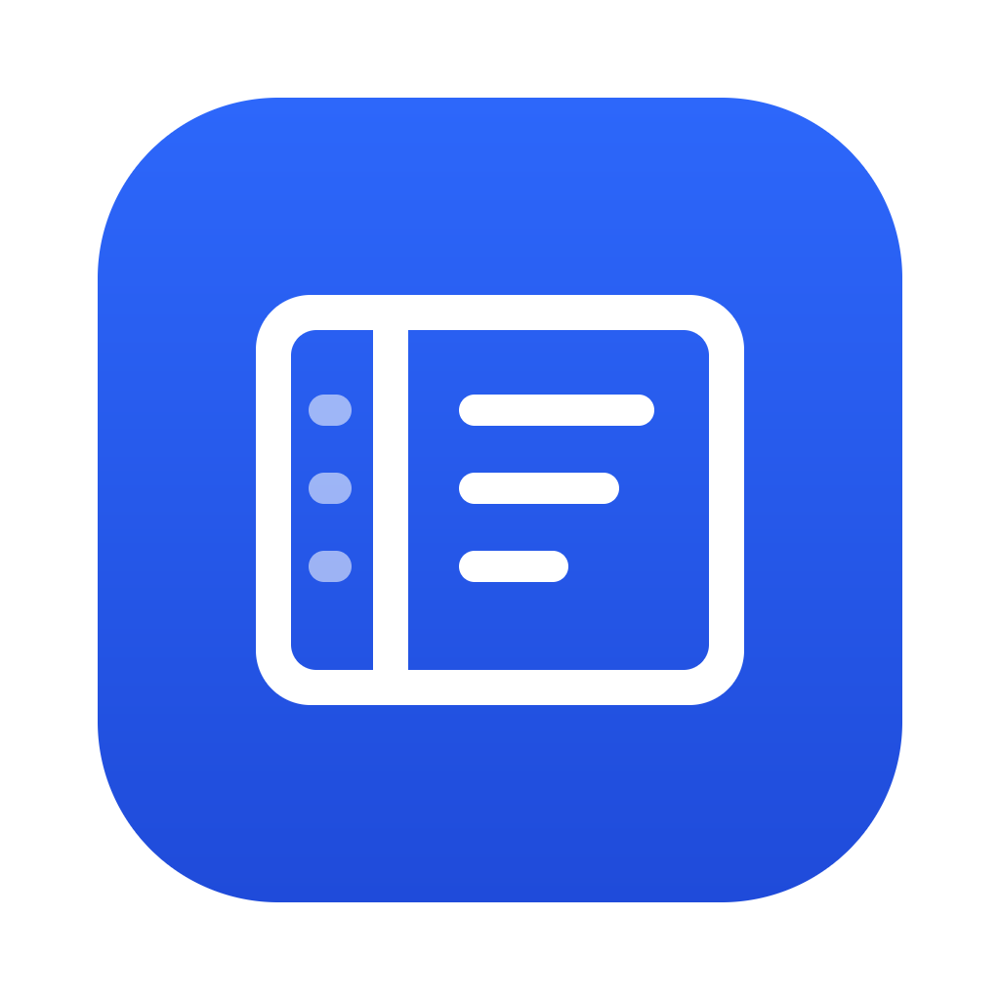
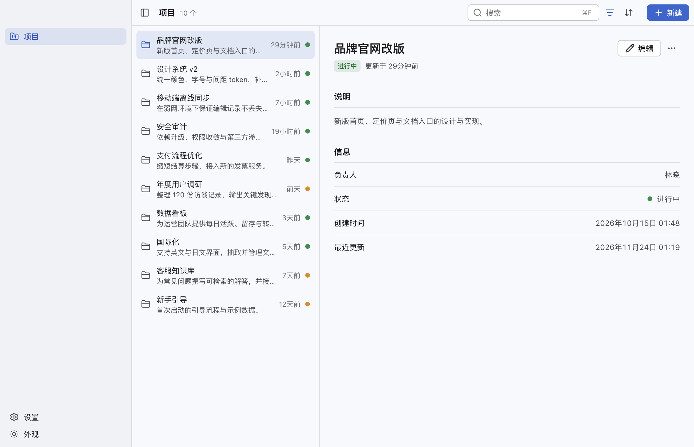
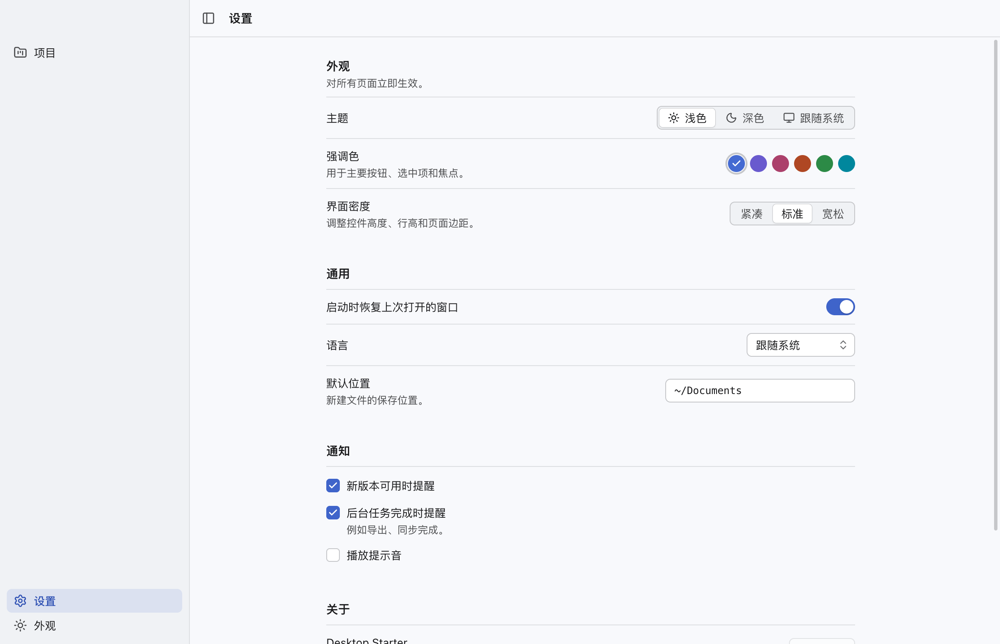
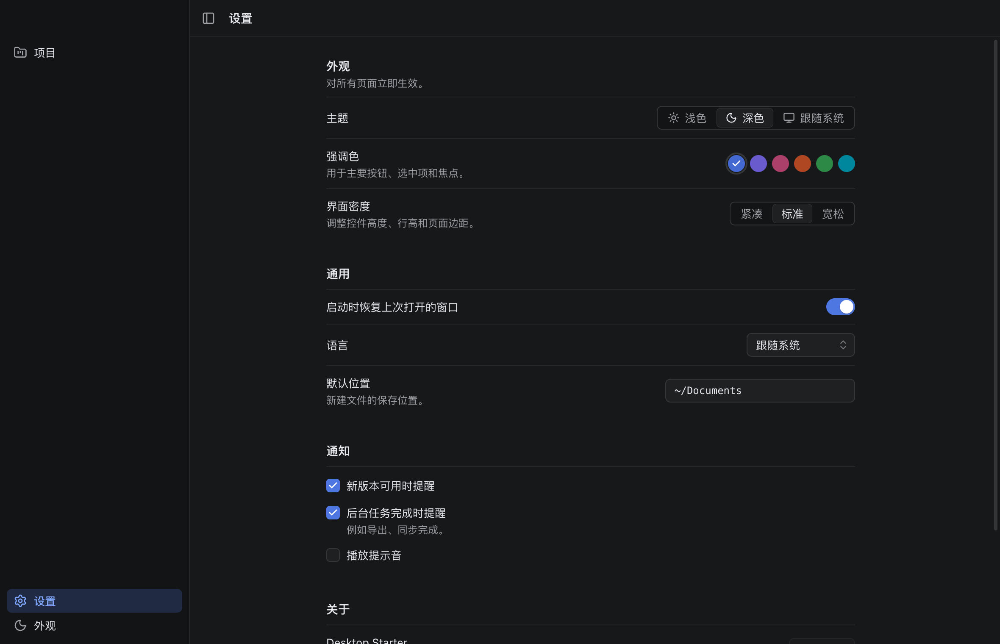

<div align="center">
  
  <h1>Desktop Starter</h1>
  <p><b>English</b> · <a href="README.zh-CN.md">简体中文</a></p>
  <p>A starting point for desktop tools: a design language you can keep building on, core components, and a window layout made of detachable parts.</p>
  <p>
    
    
    
    
    
    
  </p>
  <p>
    <a href="#quick-start">Quick start</a> ·
    <a href="#make-it-yours">Make it yours</a> ·
    <a href="docs/design-system.md">Design system</a> ·
    <a href="docs/components.md">Components</a> ·
    <a href="#faq">FAQ</a>
  </p>
</div>

<picture>
  <source media="(prefers-color-scheme: dark)" srcset="docs/screenshots/projects-dark.png" />
  
</picture>

<table>
  <tr>
    <td></td>
    <td></td>
  </tr>
</table>

<sub>The list and settings pages are examples built from the same components. You can delete both. The example UI copy is in Chinese; replace it with your product's language.</sub>

## Why

Most templates give you a home screen that has to be torn down for the next product. Desktop Starter gives you **rules you can keep**:

- **Restrained visuals.** Mostly neutral colors. The accent color is used only for primary actions, selected items and focus. Hierarchy comes from type size, spacing and 1px dividers, not from cards and shadows.
- **One config, applied everywhere.** Colors, type sizes, spacing, radii and density are defined in [`tokens.css`](src/renderer/src/styles/tokens.css). Changing the brand color or density does not require editing individual pages.
- **Consistent interaction states.** Hover, pressed, selected, disabled and keyboard focus look the same across every component. Menus, dialogs and lists all work with the keyboard alone.
- **Detachable layout.** The sidebar, toolbar and content area are independent. If you don't need a sidebar, remove one prop.
- **Light, dark and system themes.** The native title bar and window background switch along with the theme, without a white flash.
- **Business code kept separate.** `ui/` and `layout/` contain no product concepts. The template ships no chat, terminal or other feature-specific code.
- **Ready to ship.** The renderer runs in a sandbox, the app holds a single-instance lock, and electron-builder is configured to build installers for macOS, Windows and Linux.

## Quick start

**Requirements:** Node.js 22.12+ and npm 10+. Electron is downloaded automatically during the first install.

```bash
# 1. Create a project from the template (or click “Use this template” on GitHub)
git clone https://github.com/rzh-98/Desktop-Starter.git my-app && cd my-app

# 2. Install and run
npm install
npm run dev
```

| Command             | What it does                                                                  |
| ------------------- | ----------------------------------------------------------------------------- |
| `npm run dev`       | Development mode with renderer hot reload                                     |
| `npm run build`     | Type-check and build into `out/`                                              |
| `npm start`         | Run the built app                                                             |
| `npm run pack`      | Unsigned, unpacked app in `release/<version>/` for local checks               |
| `npm run dist`      | Installer for the current platform; also `dist:mac`, `dist:win`, `dist:linux` |
| `npm run typecheck` | Type-check only                                                               |
| `npm run format`    | Format with Prettier                                                          |

## Project structure

```text
├─ build/icon.png              App icon for packaging (1024×1024)
├─ resources/icon.png          Runtime window icon (Linux)
├─ electron-builder.yml        Packaging config: appId, installer formats
└─ src/
   ├─ main/                    Main process: windows, IPC handlers
   ├─ preload/                 Minimal API exposed to pages (window.desktop)
   ├─ shared/ipc.ts            Channels and types shared by main, preload and renderer
   └─ renderer/src/
      ├─ styles/tokens.css     ★ Design tokens: color, type, spacing, radius, density, dark theme
      ├─ theme/appearance.ts   Theme, accent color and density preferences
      ├─ lib/                  cn, platform helpers, localStorage, createStore
      ├─ ui/                   Generic components (no product code)
      ├─ layout/               AppShell, Sidebar, Toolbar, Page
      ├─ app/                  App shell: page auto-registration, routing, sidebar navigation
      └─ pages/                Product pages, one folder per page (the examples are removable)
```

Dependencies only point one way: `pages → app / layout / ui / lib → styles`. Imports in the opposite direction are not allowed.

## Make it yours

Work through these steps in order. Each one touches one or two files.

### 1. App name

| File                                           | Fields                                                                                                                                                      |
| ---------------------------------------------- | ----------------------------------------------------------------------------------------------------------------------------------------------------------- |
| [`package.json`](package.json)                 | `name` (lowercase kebab-case, used in installer file names), `productName` (window title, menu bar, installed app name), `description`, `author`, `version` |
| [`electron-builder.yml`](electron-builder.yml) | `appId`: use your reverse domain, such as `com.yourcompany.yourapp`. Adjust the macOS `category` if needed                                                  |

The renderer reads the name and version from `package.json` through `APP_NAME` and `APP_VERSION` ([`app/config.ts`](src/renderer/src/app/config.ts)), so you don't need to enter them anywhere else.

### 2. Icon

- `build/icon.png`: a 1024×1024 PNG. electron-builder generates `.icns` and `.ico` from it. If you need exact control over each size, add `build/icon.icns` and `build/icon.ico` yourself.
- `resources/icon.png`: a 512×512 PNG used as the Linux window icon.

For macOS, keep the artwork at about 824×824 inside the 1024 canvas, with roughly 100px of transparent margin on each side, so it matches the size of other system icons.

### 3. Brand color and visual parameters

Two lines in the `:root` block of [`tokens.css`](src/renderer/src/styles/tokens.css) set the brand color:

```css
--brand-hue: 258; /* OKLCH hue, 0–360 */
--brand-chroma: 0.17; /* saturation, typically 0.10–0.20 */
```

Hover, pressed, selected background, accent text and the focus ring are all derived from these two values, in both themes. For type sizes, spacing, radii and colors, see [Design system](docs/design-system.md#tokens).

### 4. Density

Compact, regular and comfortable are defined in `tokens.css` as `[data-density='…']`. Each level overrides control height, list row height, toolbar height and page padding. To make compact the default for your product, change `defaultAppearance.density` in [`appearance.ts`](src/renderer/src/theme/appearance.ts).

### 5. Add a page

Create a folder under `src/renderer/src/pages/` and add an `index.tsx`:

```tsx
// src/renderer/src/pages/documents/index.tsx
import { FileText } from 'lucide-react'
import { definePage } from '@/app/pages'
import { Page, PageContent, Toolbar } from '@/layout'
import { Button } from '@/ui'

function DocumentsPage() {
  return (
    <Page>
      <Toolbar title="Documents">
        <Button variant="primary">New document</Button>
      </Toolbar>
      <PageContent>…</PageContent>
    </Page>
  )
}

export default definePage({
  id: 'documents', // route: #/documents
  title: 'Documents', // sidebar label
  icon: FileText, // any lucide-react icon
  order: 20, // sidebar order, ascending
  // placement: 'bottom', // pin to the sidebar footer, like Settings
  component: DocumentsPage
})
```

The page is registered in the sidebar and router automatically and gets a ⌘1…9 / Ctrl+1…9 shortcut. No other file needs to change. Keep page-specific components, data and state in the page folder. Move a component to `ui/` only when a second page needs it.

### 6. Remove the example pages

```bash
rm -rf src/renderer/src/pages/projects src/renderer/src/pages/settings
```

The app still builds and starts, and shows a “no pages yet” prompt. The appearance follows the system, and the theme support in `appearance.ts` stays in place.

### 7. Remove the sidebar

In [`App.tsx`](src/renderer/src/app/App.tsx), change `<AppShell sidebar={…}>` to `<AppShell>`. The toolbar hides the sidebar toggle automatically and, on macOS, keeps room for the traffic-light buttons. Page code does not change.

## Components at a glance

```tsx
import { Button, Input, Menu, Dialog, List, Notice } from '@/ui'
import { AppShell, Sidebar, Toolbar, Page, PageContent } from '@/layout'
import { createStore } from '@/lib/store'
```

| Category | Contents                                                                                                                             |
| -------- | ------------------------------------------------------------------------------------------------------------------------------------ |
| Layout   | `AppShell` (collapsible, resizable sidebar), `Sidebar*`, `Toolbar`, `Page`, `PageContent`                                            |
| Actions  | `Button`, `IconButton`, `Menu*`, `ContextMenu*`                                                                                      |
| Forms    | `Input`, `Textarea`, `Select`, `Switch`, `Checkbox`, `SegmentedControl`, `Field`, `FormRow`                                          |
| Overlays | `Dialog*`, `ConfirmDialog`, `Tooltip`                                                                                                |
| Data     | `List`, `ListItem`, `ListHeader`, `Badge`, `StatusDot`, `Kbd`                                                                        |
| Feedback | `Notice` (action results and recoverable errors below the toolbar, with optional Undo), `EmptyState`                                 |
| State    | `createStore`: a small store shared across pages, optionally persisted; used by appearance preferences and the example settings page |

See [Components](docs/components.md) for props, examples and keyboard behavior.

## Architecture and security

- The renderer runs with `contextIsolation` and `sandbox` enabled and `nodeIntegration` disabled. External links open in the system browser.
- Pages reach system features only through `window.desktop`. The preload script exposes it explicitly, and its types live in [`shared/ipc.ts`](src/shared/ipc.ts).
- Adding a system feature usually takes three steps:
  1. Add the channel name and the `DesktopApi` method signature to `shared/ipc.ts`.
  2. Implement it with `ipcMain.handle` in `main/index.ts`, and **validate every argument**.
  3. Expose the method with `ipcRenderer.invoke` in `preload/index.ts`.
- React, Radix and the icon library are bundled by Vite, so they belong in `devDependencies`. Only packages the main process `require`s at runtime go in `dependencies`.

## Packaging and release

```bash
npm run pack   # quick check: unsigned, output in release/<version>/
npm run dist   # installers: dmg+zip on macOS, nsis on Windows, AppImage on Linux
```

- **macOS:** `dist` signs with the developer certificate in your keychain. Before distributing publicly, set up notarization as described in the [electron-builder docs](https://www.electron.build/code-signing-mac).
- **Windows:** you need a code-signing certificate; otherwise users see a SmartScreen warning.
- **Cross-platform:** build each platform on its own CI runner instead of cross-building on one machine.

## FAQ

<details>
<summary>The macOS menu bar says “Electron” in development</summary>

In development, the app runs inside Electron's own app bundle, so the menu bar shows “Electron”. After `npm run pack` or `npm run dist`, it shows your `productName`.

</details>

<details>
<summary><code>npm run dist</code> hangs or asks for keychain access</summary>

electron-builder is reading your signing certificate. Allow access and packaging continues. For local checks, use `npm run pack`, which skips signing.

</details>

<details>
<summary>Why can't I use classes like <code>bg-blue-500</code>?</summary>

The template removes Tailwind's default palette and keeps only semantic tokens such as `bg-accent`, `text-fg-muted` and `h-control`. That way every page stays consistent when you change the brand color or switch to the dark theme. If you need a new color, define a semantic variable in `tokens.css` first.

</details>

<details>
<summary>Where are user preferences stored?</summary>

In the renderer's `localStorage`, managed with `createStore(key, initial)`. If the main process needs to read the data, or you want it stored as a file, send it to the main process over IPC and write it under `app.getPath('userData')`.

</details>

<details>
<summary>Can I use pnpm or yarn?</summary>

Yes. Delete `package-lock.json` and reinstall. pnpm 10 blocks dependency install scripts by default, so allow `electron` in `pnpm.onlyBuiltDependencies`; otherwise the Electron binary is not downloaded.

</details>

## Scope

The template **includes** design tokens, generic components, the window layout, theming, page registration and packaging config.
It **does not include** product features (chat, terminal, editor and so on), a data layer, an i18n framework or auto-update, because those choices vary from product to product.

Follow the [design rules](docs/design-system.md#design-rules) so new pages share the same visual language as existing ones.

## License

[MIT](package.json). After creating your own product from the template, replace the license and `author` with your own.
