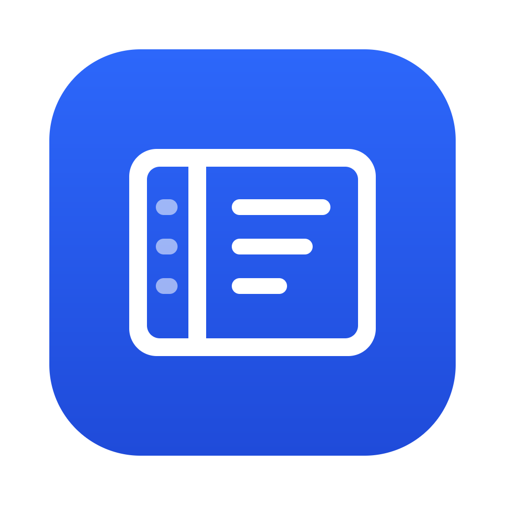
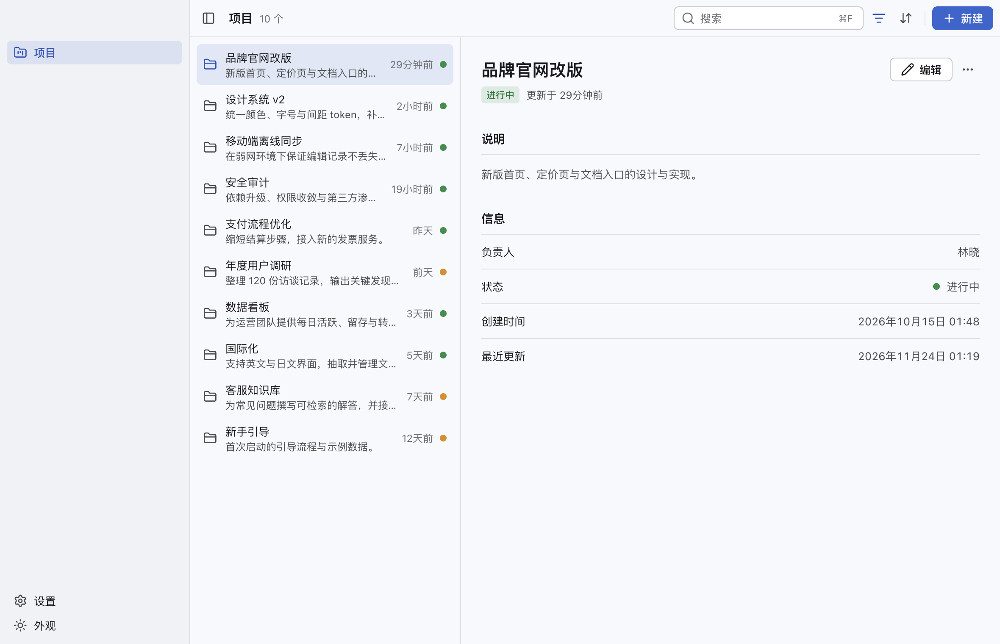
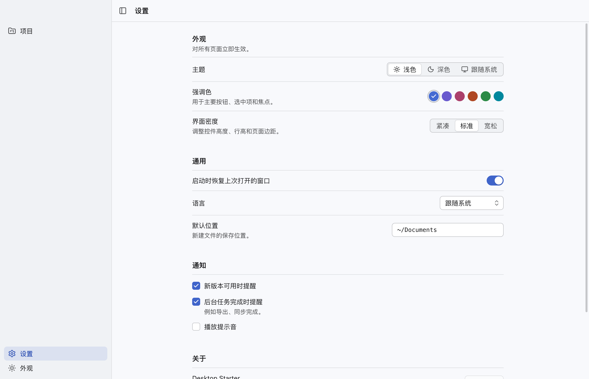
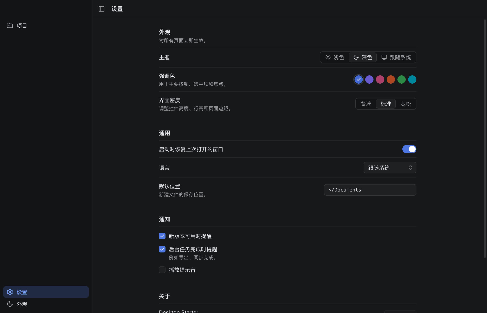

<div align="center">
  
  <h1>Desktop Starter</h1>
  <p><a href="README.md">English</a> · <b>简体中文</b></p>
  <p>为桌面工具类软件准备的起点：一套可延续的设计语言、基础组件和可拆卸的窗口布局。</p>
  <p>
    <a href="https://github.com/rzh-98/Desktop-Starter/actions/workflows/build.yml"></a>
    
    
    
    
    
    
  </p>
  <p>
    <a href="#快速开始">快速开始</a> ·
    <a href="#改成你的产品">改成你的产品</a> ·
    <a href="docs/design-system.zh-CN.md">设计系统</a> ·
    <a href="docs/components.zh-CN.md">组件 API</a> ·
    <a href="#常见问题">常见问题</a>
  </p>
</div>

<picture>
  <source media="(prefers-color-scheme: dark)" srcset="docs/screenshots/projects-dark.png" />
  
</picture>

<table>
  <tr>
    <td></td>
    <td></td>
  </tr>
</table>

<sub>截图中的列表页和设置页都是示例，用同一套组件搭成，可以整体删除。</sub>

## 为什么用它

大多数模板给的是一张首页，换个产品就要推倒重来。Desktop Starter 提供的是**可以延续的规则**：

- **克制的视觉**：以中性色为主，强调色只用于主操作、选中项和焦点。层级靠字号、间距和 1px 细线建立，不靠卡片和阴影。
- **一处配置，全局生效**：颜色、字号、间距、圆角和密度都集中在 [`tokens.css`](src/renderer/src/styles/tokens.css)。换品牌色或调整密度时，不需要逐页修改。
- **统一的交互状态**：悬停、按下、选中、禁用和键盘焦点在所有组件中保持一致；菜单、对话框和列表都能只用键盘操作。
- **布局可以拆开用**：侧栏、工具栏和内容区彼此独立。不需要侧栏时，删掉一个属性即可。
- **浅色、深色、跟随系统**：原生标题栏和窗口背景会同步切换，切换时不会闪白。
- **业务与通用分离**：`ui/` 和 `layout/` 不包含业务概念。模板也不预装聊天、终端等特定功能。
- **开箱可发布**：已配置渲染进程沙箱、单实例锁和 electron-builder，可打包 macOS、Windows、Linux 安装包。

## 快速开始

**选择桌面运行时。** 两个版本共用 React 页面、组件、设计 token 和存储逻辑，每个安装包只包含一种外壳。应用标识不同，可以并排安装；本地数据不会自动互通。

| 外壳             | `npm ci` 后启动     | 打包                  | 环境要求                                                                           |
| ---------------- | ------------------- | --------------------- | ---------------------------------------------------------------------------------- |
| Electron（默认） | `npm run dev`       | `npm run dist`        | Node.js，不需要 Rust                                                               |
| Tauri 2          | `npm run tauri:dev` | `npm run tauri:build` | Node.js、稳定版 Rust 和[各平台前置依赖](https://v2.tauri.app/start/prerequisites/) |

Tauri 的应用标识、产品名和窗口标题在 `src-tauri/tauri.conf.json` 设置；版本沿用 `package.json`。用 `npx tauri icon resources/icon.png` 生成原生图标，安装包输出到 `src-tauri/target/release/bundle/`。Windows 使用 WebView2，macOS 使用 WKWebView，Linux 需要 WebKitGTK 4.1。新增原生能力时扩展共享的 `DesktopApi`，分别在两套适配层实现，不要在页面中导入外壳 API。

只保留 Electron：删除 `src-tauri/`、Tauri 的 Vite 配置、渲染器 `tauri.ts`、`tauri:*`/`web:*` 命令、`@tauri-apps/*` 依赖和对应 CI 任务及发布依赖。只保留 Tauri：删除 `src/main/`、`src/preload/`、Electron 配置与依赖、Electron 命令（含 `postinstall`）、`main` 字段、对应 CI 任务及发布依赖，并去掉旧 Node tsconfig 引用。保留 `src/shared/` 和渲染器，调整依赖后运行 `npm install`。

CI 为两种外壳分别打包。Actions 提供安装包和截图，任务摘要记录安装包 MiB 与启动 8 秒后的进程树 RSS。RSS 可能重复计入共享页，也可能遗漏系统托管的 WebView 进程，不代表整机内存开销。

**环境要求**：Node.js 22.12+、npm 10+。首次安装时会自动下载 Electron。

```bash
# 1. 从模板创建项目（也可以在 GitHub 上点击 “Use this template”）
git clone https://github.com/rzh-98/Desktop-Starter.git my-app && cd my-app

# 2. 安装依赖并启动
npm install
npm run dev
```

| 命令                | 作用                                                                |
| ------------------- | ------------------------------------------------------------------- |
| `npm run dev`       | 开发模式，渲染进程热更新                                            |
| `npm run build`     | 类型检查并构建到 `out/`                                             |
| `npm start`         | 运行构建产物                                                        |
| `npm run pack`      | 生成未压缩、未签名的应用目录 `release/<version>/`，用于本地验证     |
| `npm run dist`      | 为当前平台生成安装包；也可以用 `dist:mac`、`dist:win`、`dist:linux` |
| `npm run typecheck` | 只做类型检查                                                        |
| `npm run format`    | 用 Prettier 格式化代码                                              |

## 项目结构

```text
├─ build/icon.png              打包图标（1024×1024）
├─ resources/icon.png          运行时窗口图标（Linux）
├─ electron-builder.yml        打包配置：appId、安装包格式
└─ src/
   ├─ main/                    主进程：窗口、IPC 处理
   ├─ preload/                 向页面暴露最小 API（window.desktop）
   ├─ shared/ipc.ts            主进程、预加载脚本、渲染进程共用的通道与类型
   └─ renderer/src/
      ├─ styles/tokens.css     ★ 设计 token：颜色、字号、间距、圆角、密度、深色主题
      ├─ theme/appearance.ts   主题、强调色和密度偏好
      ├─ lib/                  cn、平台判断、localStorage、createStore
      ├─ ui/                   通用组件（不包含业务代码）
      ├─ layout/               AppShell、Sidebar、Toolbar、Page
      ├─ app/                  应用外壳：页面自动注册、路由、侧栏导航
      └─ pages/                业务页面，一个文件夹对应一个页面（示例页可以删除）
```

依赖方向固定为 `pages → app / layout / ui / lib → styles`，反向引用不允许出现。

## 改成你的产品

一般按下面的顺序修改。每一步只涉及一到两个文件。

### 1. 应用名称

| 文件                                           | 字段                                                                                                                            |
| ---------------------------------------------- | ------------------------------------------------------------------------------------------------------------------------------- |
| [`package.json`](package.json)                 | `name`（小写加短横线，用于安装包文件名）、`productName`（窗口标题、菜单栏和安装后的应用名）、`description`、`author`、`version` |
| [`electron-builder.yml`](electron-builder.yml) | `appId`，改成你的反向域名，如 `com.yourcompany.yourapp`；macOS 的 `category` 也可以按需修改                                     |

渲染进程通过 `APP_NAME` 和 `APP_VERSION`（[`app/config.ts`](src/renderer/src/app/config.ts)）读取 `package.json`，不需要在其他地方重复填写。

### 2. 图标

- `build/icon.png`：1024×1024 PNG。electron-builder 会据此生成 `.icns` 和 `.ico`；需要精确控制各尺寸时，可以直接放入 `build/icon.icns` 和 `build/icon.ico`。
- `resources/icon.png`：512×512 PNG，用作 Linux 窗口图标。

macOS 图标在 1024 画布内的主体建议约为 824×824，四周留出约 100px 透明边距，这样才和系统中的其他图标大小一致。

### 3. 品牌色与视觉参数

在 [`tokens.css`](src/renderer/src/styles/tokens.css) 的 `:root` 中修改两行，就能更换品牌色：

```css
--brand-hue: 258; /* OKLCH 色相 0–360 */
--brand-chroma: 0.17; /* 饱和度，常用 0.10–0.20 */
```

悬停色、按下色、选中底色、强调文字和焦点环都会由这两个值推导出来，两种主题会同时生效。字号、间距、圆角和配色的完整说明见[设计系统](docs/design-system.zh-CN.md#token)。

### 4. 界面密度

紧凑、标准和宽松三档都在 `tokens.css` 中定义为 `[data-density='…']`，各档会覆盖控件高度、列表行高、工具栏高度和页面边距。如果想把产品默认值改成“紧凑”，请修改 [`appearance.ts`](src/renderer/src/theme/appearance.ts) 中的 `defaultAppearance.density`。

### 5. 添加页面

在 `src/renderer/src/pages/` 下新建一个文件夹，并放入 `index.tsx`：

```tsx
// src/renderer/src/pages/documents/index.tsx
import { FileText } from 'lucide-react'
import { definePage } from '@/app/pages'
import { Page, PageContent, Toolbar } from '@/layout'
import { Button } from '@/ui'

function DocumentsPage() {
  return (
    <Page>
      <Toolbar title="文档">
        <Button variant="primary">新建文档</Button>
      </Toolbar>
      <PageContent>…</PageContent>
    </Page>
  )
}

export default definePage({
  id: 'documents', // 路由 #/documents
  title: '文档', // 侧栏名称
  icon: FileText, // 任意 lucide-react 图标
  order: 20, // 侧栏排序，数字小的在前
  // placement: 'bottom', // 固定在侧栏底部，如“设置”
  component: DocumentsPage
})
```

页面会自动注册到侧栏和路由，也会自动获得 ⌘1…9 或 Ctrl+1…9 快捷键，不需要修改其他文件。页面专用的组件、数据和状态都放在同一个文件夹里。只有当第二个页面也需要某个组件时，才把它提升到 `ui/`。

### 6. 删除示例页面

```bash
rm -rf src/renderer/src/pages/projects src/renderer/src/pages/settings
```

```powershell
# Windows PowerShell
Remove-Item -Recurse -Force src/renderer/src/pages/projects, src/renderer/src/pages/settings
```

删除后，应用仍能正常构建和启动，并显示“还没有页面”的引导。此时外观会跟随系统，`appearance.ts` 中的主题能力仍然保留。

### 7. 去掉侧栏

在 [`App.tsx`](src/renderer/src/app/App.tsx) 中把 `<AppShell sidebar={…}>` 改为 `<AppShell>`。工具栏会自动隐藏侧栏开关；在 macOS 上，它还会为红绿灯按钮留出位置。页面代码不需要修改。

## 基础组件一览

```tsx
import { Button, Input, Menu, Dialog, List, Notice } from '@/ui'
import { AppShell, Sidebar, Toolbar, Page, PageContent } from '@/layout'
import { createStore } from '@/lib/store'
```

| 分类 | 内容                                                                                        |
| ---- | ------------------------------------------------------------------------------------------- |
| 布局 | `AppShell`（可折叠、可拖宽侧栏）、`Sidebar*`、`Toolbar`、`Page`、`PageContent`              |
| 操作 | `Button`、`IconButton`、`Menu*`、`ContextMenu*`                                             |
| 表单 | `Input`、`Textarea`、`Select`、`Switch`、`Checkbox`、`SegmentedControl`、`Field`、`FormRow` |
| 浮层 | `Dialog*`、`ConfirmDialog`、`Tooltip`                                                       |
| 数据 | `List`、`ListItem`、`ListHeader`、`Badge`、`StatusDot`、`Kbd`                               |
| 反馈 | `Notice`（工具栏下方的操作结果和可恢复错误，可带“撤销”）、`EmptyState`                      |
| 状态 | `createStore`：跨页面共享、可选持久化的小型 store；主题偏好和示例设置页都使用它             |

每个组件的属性、示例和键盘行为见[组件 API](docs/components.zh-CN.md)。

## 架构与安全

- 渲染进程启用 `contextIsolation` 和 `sandbox`，并关闭 `nodeIntegration`；外部链接会在系统浏览器中打开。
- 页面只能通过 `window.desktop` 访问系统能力。这个对象由 preload 显式暴露，类型定义在 [`shared/ipc.ts`](src/shared/ipc.ts)。
- 新增一项系统能力通常需要三步：
  1. 在 `shared/ipc.ts` 中添加通道名和 `DesktopApi` 方法签名；
  2. 在 `main/index.ts` 中用 `ipcMain.handle` 实现，并**校验所有参数**；
  3. 在 `preload/index.ts` 中用 `ipcRenderer.invoke` 暴露该方法。
- React、Radix 和图标库都会被 Vite 打进产物，所以放在 `devDependencies`。只有主进程运行时需要 `require` 的包，才放入 `dependencies`。

## 平台说明

同一份代码可以在 macOS、Windows 和 Linux 上运行。仓库中没有平台专用脚本，各系统使用相同的命令。

| 平台            | 标题栏与菜单                                                                                                                                     | 快捷键                 |
| --------------- | ------------------------------------------------------------------------------------------------------------------------------------------------ | ---------------------- |
| macOS           | 一体化标题栏（`hiddenInset`）。侧栏顶部和工具栏可以拖动窗口；在任意密度下，红绿灯按钮都会在工具栏中垂直居中                                      | `⌘`                    |
| Windows / Linux | 系统原生标题栏，随浅色或深色主题切换。Electron 默认的 File / Edit / View 菜单已隐藏：开发时按 Alt 仍可调出（用于 DevTools 和刷新），打包后会移除 | `Ctrl`，显示为 `Ctrl+` |

- 快捷键的判断和显示都通过 `@/lib/platform` 中的 `isModKey` 和 `modKey` 处理，新页面会自动适配。
- `.gitattributes` 固定使用 LF 换行，因此在 Windows 上 `git clone` 后，Prettier 检查不会失败。
- 如果希望 Windows 标题栏与工具栏融为一体，可以研究 Electron 的 `titleBarStyle: 'hidden'` 和 `titleBarOverlay`。模板默认保留原生标题栏，这是最稳妥的选择。

## 打包与发布

```bash
npm run pack   # 快速验证：不签名，输出到 release/<version>/
npm run dist   # 正式安装包：mac 为 dmg+zip，Windows 为 nsis，Linux 为 AppImage
```

- **macOS**：`dist` 会使用钥匙串中的开发者证书签名。公开分发前，还需要按照 [electron-builder 文档](https://www.electron.build/code-signing-mac)配置公证。
- **Windows**：在 Windows 上运行 `npm run dist:win`，即可生成 NSIS 安装包。没有代码签名证书时，用户会看到 SmartScreen 警告。
- **跨平台**：建议分别在对应平台的机器或 CI runner 上构建（见下文）。在 macOS 上，`npx electron-builder --win --dir` 可以生成未打包成安装程序的 Windows 应用，用于快速检查；但在 Apple Silicon 上生成 NSIS 安装包需要 Rosetta，或者改用 Windows 机器。

### 持续集成

[`.github/workflows/build.yml`](.github/workflows/build.yml) 会在推送到 `main`、提交 Pull Request 时自动运行，也可以在 Actions 页手动触发。它在 Windows、macOS 和 Linux 上并行构建：

1. 执行 `npm ci`、Prettier 检查（仅 Linux），然后类型检查、构建并打包。
2. 冒烟测试（[`.github/scripts/smoke.mjs`](.github/scripts/smoke.mjs)）启动打包后的应用，确认界面正常加载并保存截图。
3. 安装包和截图作为 artifact 上传，可在 Actions 页对应运行记录中下载。

发布正式版本时，推送版本 tag 即可。工作流会把三个平台的安装包附加到 GitHub Release：

```bash
npm version patch          # 更新 package.json 并创建 tag，例如 v0.1.1
git push --follow-tags
```

CI 产物未签名。公开仓库使用 GitHub 标准托管 runner 免费；私有仓库消耗账号每月的 Actions 额度。不需要 CI 时，删除 `.github` 文件夹即可。

## 常见问题

<details>
<summary>开发模式下，macOS 菜单栏显示的是 “Electron”</summary>

开发时运行的是 Electron 自带的应用包，所以菜单栏显示 “Electron”。用 `npm run pack` 或 `npm run dist` 打包后，会显示 `productName`。

</details>

<details>
<summary><code>npm run dist</code> 卡住，或者弹出钥匙串授权</summary>

electron-builder 在读取签名证书。允许访问后，打包会继续。如果只想在本地验证，可以使用不签名的 `npm run pack`。

</details>

<details>
<summary>为什么不能写 <code>bg-blue-500</code> 这类类名？</summary>

模板移除了 Tailwind 默认调色板，只保留语义 token，例如 `bg-accent`、`text-fg-muted`、`h-control`。这样一来，更换品牌色或进入深色主题时，所有页面都能保持一致。需要新颜色时，请先在 `tokens.css` 中定义语义变量。

</details>

<details>
<summary>用户偏好保存在哪里？</summary>

偏好保存在渲染进程的 `localStorage` 中，并通过 `createStore(key, initial)` 管理。如果数据需要被主进程读取，或者需要以文件形式同步，可以通过 IPC 交给主进程，再写入 `app.getPath('userData')`。

</details>

<details>
<summary>能不能换成 pnpm 或 yarn？</summary>

可以。删除 `package-lock.json` 后重新安装即可。pnpm 10 默认会拦截依赖的安装脚本，需要在 `pnpm.onlyBuiltDependencies` 中允许 `electron`，否则不会下载 Electron 二进制。

</details>

## 范围

模板**会包含**设计 token、通用组件、窗口布局、主题、页面注册和打包配置。
模板**不会包含**具体业务功能（聊天、终端、编辑器等）、数据层、国际化框架或自动更新，因为这些选择会随产品而变化。

设计时请遵守[设计规则](docs/design-system.zh-CN.md#设计规则)，这样新页面和已有页面才能保持同一套视觉语言。

## 许可证

[MIT](package.json)。从模板创建你自己的产品后，请把许可证和 `author` 换成你自己的信息。
